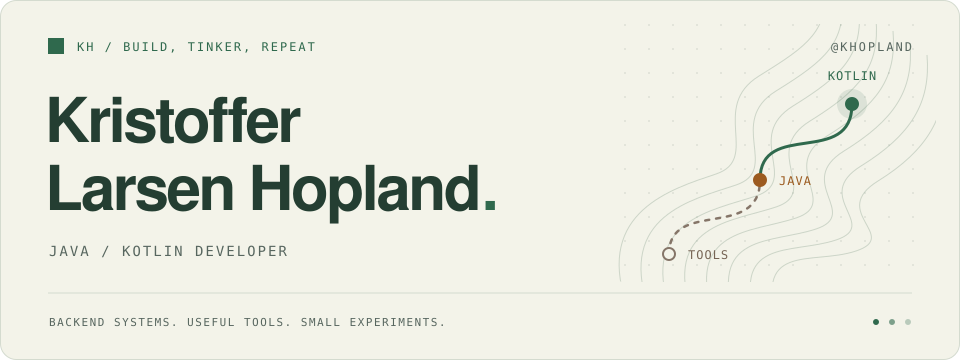

<picture>
  <source media="(prefers-color-scheme: dark)" srcset="./assets/header-dark.svg">
  <source media="(prefers-color-scheme: light)" srcset="./assets/header-light.svg">
  
</picture>

# Backend developer. Tool builder.

I'm **Kristoffer Larsen Hopland**, a **Java and Kotlin developer**. I build backend services, JVM libraries, and tools that make development less fiddly—from dependency checks in IntelliJ to clearer XML validation errors.

[LinkedIn ↗](https://www.linkedin.com/in/kristoffer-larsen-hopland-1391a814a/) · [Explore my repositories ↗](https://github.com/khopland?tab=repositories)

## Selected projects

A selection of my libraries, plugins, and tools:

- **[Version Checker](https://github.com/khopland/idea-version-checker)** · Kotlin — Find and review dependency updates inside IntelliJ IDEA, across Maven, Gradle, npm, pnpm, Yarn, and Bun.
- **[Better XSD Validation](https://github.com/khopland/xsd-validator)** · Java — Turn XML validation failures into structured reports with useful paths and expected elements, while keeping raw XML values out of diagnostics.
- **[SSE Update](https://github.com/khopland/spring-boot-sse-update-starter)** · Java / Spring Boot — Send live updates across application instances, with local, JMS, and JDBC transports, plus a working sample application.
- **[IDE Layout Profiles](https://github.com/khopland/ide-layout-profiles)** · Kotlin — Save and switch IntelliJ workspace layouts, including tool windows, editor tabs, and toolbar settings.
- **[Dependency Snapshot](https://github.com/khopland/dependency-snapshot)** · Java / Maven — Track changes in resolved dependencies, including transitives, and produce text and JSON reports between builds.
- **[HTML Plan Host](https://github.com/khopland/html-plan-hosting)** · TypeScript / Cloudflare Workers — Turn an HTML file into a temporary shareable page, with immutable revisions and version history.

## The toolkit

| Where | What I work with |
| :--- | :--- |
| **On the JVM** | Kotlin · Java · Spring Boot · Quarkus |
| **Designing services** | Microservices · event-driven architecture · DDD |
| **Getting it running** | Docker · Kubernetes · Azure · GitHub Actions |
| **Other experiments** | Rust · TypeScript · Cloudflare Workers |

Off the main path: [Emberkai themes for IntelliJ](https://github.com/khopland/emberkai-intellij) and the occasional [Advent of Code puzzle](https://github.com/khopland/advent-of-code).

## Recently at the keyboard

<details>
<summary>The last 30 days · coding activity · updated weekly</summary>

<!--START_SECTION:waka-->

```txt
Kotlin                                  ⣿⣿⣿⣿⣿⣿⣿⣿⣿⣿⣀⣀⣀⣀⣀⣀⣀⣀⣀⣀⣀⣀⣀⣀⣀   39.99 %
Markdown                                ⣿⣿⣿⣿⣿⣿⣦⣀⣀⣀⣀⣀⣀⣀⣀⣀⣀⣀⣀⣀⣀⣀⣀⣀⣀   25.90 %
Java                                    ⣿⣿⣿⣿⣀⣀⣀⣀⣀⣀⣀⣀⣀⣀⣀⣀⣀⣀⣀⣀⣀⣀⣀⣀⣀   16.26 %
Html                                    ⣿⣤⣀⣀⣀⣀⣀⣀⣀⣀⣀⣀⣀⣀⣀⣀⣀⣀⣀⣀⣀⣀⣀⣀⣀   05.05 %
XML                                     ⣿⣀⣀⣀⣀⣀⣀⣀⣀⣀⣀⣀⣀⣀⣀⣀⣀⣀⣀⣀⣀⣀⣀⣀⣀   03.75 %
```

<!--END_SECTION:waka-->

</details>

---

Always happy to compare notes on JVM development, backend design, or IDE tooling. **[Say hello on LinkedIn →](https://www.linkedin.com/in/kristoffer-larsen-hopland-1391a814a/)**
